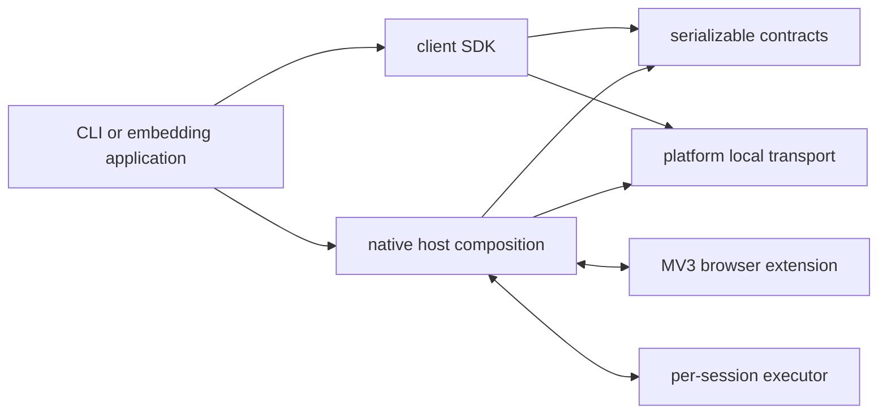

# Product boundaries

One native browser engine serves the standalone CLI and embedding consumers. The browser starts
the desktop host through native messaging; callers use its private local control socket. The
extension grants tab authority, and the host owns generations, executors and drained termination.

| Component | Owns | Depends on product components |
|---|---|---|
| `crates/contract` | Control requests/replies, settings and generated browser projections | None |
| `crates/local-transport` | Unix/Windows local stream sockets | None |
| `crates/client` | Application port, cancellable bounded RPC client and transport outcomes | Contract, local transport |
| Root native package | Configuration, installation, host, CLI and phone adapter composition | Contract, client, local transport |
| `tools` | Repeatable checks, generation and release packaging | Contract |

The extension's React views live in feature folders for the popup, group dashboard and shared
locale/theme controls. They render the generated owner projections; browser authority remains
in the worker and native host. Browser entry points share production bundles, and generation
removes obsolete emitted modules. Vitest checks the TypeScript behavior and components; isolated
Chromium acceptance checks the complete product, including consent, privacy and owner controls.

The SDK has no native-host, installer, configuration or NDS runtime dependency. Its constructor
accepts an explicit absolute socket path and has no process or global telemetry side effects.
The root package also offers the installed-configuration client constructor for the standalone
composition. All clients use the same contract and RPC implementation.

The workspace manifest declares the component graph. `just check` rejects forbidden local
dependency edges, non-inherited dependency versions and missing shared safety/visibility lints.
One workspace table owns Rust versions and shared dependency configuration. Compiler visibility keeps host
internals out of the public SDK. The runtime crates share one workspace release version.
Native behavior tests run through nextest; documentation tests remain a separate Cargo pass.

## Session ownership

An owned session handle identifies one generation. A caller reserves it before opening, keeps
it through cancellation, and retains it until close is acknowledged. The host fences admission,
stops and reaps execution, confirms release of browser authority, then removes session artifacts.
An interrupted external action remains uncertain even when that browser authority has ended.

The host also expires abandoned idle generations, including reservations and managed callers.
Execution and active recording protect a session from idle expiry. The extension independently
ends abandoned browser groups on native-port loss and recovers them by a durable owner control
tab. Neither a page's title nor a restored numeric group ID grants recovery authority.

## Embedding boundary

An embedding system owns its actor/device context, process supervision, consent policy and
telemetry composition. It maps them to SDK operations and their typed outcomes. It does not copy
the browser engine or make this product depend on its runtime. Native messaging remains the
browser's transport; embedding adds no public debugging endpoint or cloud relay.

See [integration](integration.md) for the capability and lifecycle contract, and
[desktop browsers](desktop.md) for browser-resource cleanup.
